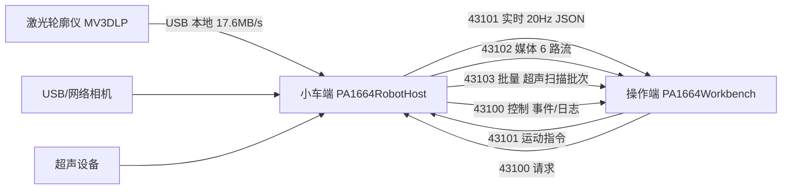

## 用户需求

对 PA1664 爬壁机器人项目做一次全局「数据传输减压」优化：操作端只负责显示数据与下发指令，全部计算与执行都在小车端主板上完成。要求输出整体优化方案，并且**不能影响任何功能和算法**。

## 澄清后的约束

- 主 KPI：**网络带宽**（降低 100M 网口压力，减少卡顿与丢包），CPU/磁盘为附带收益
- **必须持续推送**：任何时刻切换面板都要立刻有画面，不做「不可见就停流」的可见性门控
- **允许改两端通信协议**，小车端与操作端同步升级即可
- **不改功能与算法**：检测算法、采集丢帧语义、超声扫描数据的顺序与完整性一律不动
- 交付方式：方案 + 分阶段实施，每阶段可独立编译、验证、回滚

## 核心诉求拆解

1. 找出链路上「同样的信息被重复传、被放大传、或根本没被消费却仍在传」的部分
2. 在保持所有面板实时可见的前提下，用更少字节表达同样信息
3. 给出可量化的改善幅度与验证方法，而不是只做定性描述

## 一、现状诊断（均已读源码核实）

### 链路拓扑



### 已确认的三类浪费

**1）无人消费的流与重复通道**

| 问题 | 证据 |
| --- | --- |
| 激光灰度图 0x0201 在操作端**没有任何消费者** | `src/robotcontrolpanel.cpp:4282-4285` 只执行 `m_laserImage = image`，全仓 `m_laserImage` 仅声明+赋值，无读取点 |
| 同一帧图像/点云有**两条提交路径** | `src/backend/robot_peripheral_host_service.cpp:459-485`：`cameraImageFrameChanged`(50ms 节流) 与 `correctionCameraFrameReady`(逐帧不节流) 同进一个邮箱 |
| 同一条日志走**两条 TCP 事件** | `robot_peripheral_host_service.cpp:1646-1653` 发 `robot.log`，`src/backend/host_application.cpp:175-183` 又转成 `robot.peripheral.log` |
| 纠偏状态走**媒体 + 控制双通道** | `robot_peripheral_host_service.cpp:1619-1638` |
| 运动包与心跳冗余 | `src/common/transport/realtime_channel.cpp:429-431` 已把 MotionSetpoint 当心跳；`167-172` 静止时仍 12.5Hz 发 0/0 空包；`348-353` `sendAcknowledge` 为死代码 |


**2）编码与传输开销**

| 问题 | 证据 | 影响 |
| --- | --- | --- |
| 点云每点 float32×3 = 12 B，且 raw 单行 profile 可达 2048 点 | `src/common/services/workbench_data_codec.cpp:310-319`、`src/robot_sensor_controller.cpp:639-652` | 载荷与 `qCompress` 耗时翻倍 |
| 媒体分片有效载荷仅 1126 B（头 58 + HMAC 16） | `src/common/transport/media_channel.cpp:16-17` | 开销 6.6%，分片数偏多 |
| USB 相机 15 Hz 推送，但操作端 UI 每 100 ms 才刷新一次 | `robot_peripheral_host_service.cpp` `kUsbImageIntervalMs=66` vs `robotcontrolpanel.cpp:4266-4272` | 三分之一帧白传 |
| 激光 JPEG 全分辨率编码 q78 | `robot_peripheral_host_service.cpp:195-205` | 图像模式下 5–15 ms/次 CPU |


**3）接收侧线程压力**

- `robotcontrolpanel.cpp:1178-1260` 在 **UI 线程**做 JPEG 解码、`qUncompress`、点云反序列化

## 二、优化策略（不改功能与算法的前提下）

核心原则：**不减少信息，只减少表达信息所需的字节**。

| 措施 | 带宽收益 | 功能影响 | 风险 |
| --- | --- | --- | --- |
| 停止发布 0x0201 激光灰度图（保留解码分支） | 图像模式 16–32 Mbps → 0 | 无（无消费者） | 极低 |
| 合并双提交路径为单一邮箱 | 消除重复编码 | 无 | 低 |
| 日志/纠偏状态单通道 + 事件降频 | 控制通道小幅下降 | 日志内容不变 | 低 |
| 媒体分片 1126 → 1400 B | 分片数 -20%，开销 6.6%→5.2% | 无 | 低（需能力协商） |
| 点云 int16 量化（每帧基准+比例），固定显示预算 | 12 B/点 → 6 B/点，载荷再压缩后 -50~70% | 显示等效（亚毫米级） | 中（需两端同步） |
| 点云单一语义（显示只发降采样云） | 消除 raw 单行大包 | 显示不变 | 低 |
| USB 相机 10 Hz（与 UI 刷新对齐）+ 按目标尺寸编码 | -33% | 视觉无变化 | 低 |
| 遥测二进制编码替代 JSON | -80% 控制通道载荷 | 数值不变 | 低 |
| 心跳/空运动包去重 | 4 包/秒 + 12.5 Hz 空包 | 看门狗语义保留 | 低 |
| 超声 batch 聚合与压缩复用、PNG 变更检测 | 20–30% | 顺序/完整性不变 | 中 |
| 操作端解码移出 UI 线程 | 带宽不变，UI 更稳 | 无 | 低 |


### 预估改善程度

| 工况 | 当前 | 优化后 | 降幅 |
| --- | --- | --- | --- |
| A 激光轮廓 + 双 USB 相机（巡检常态） | 3.1–5.5 Mbps | 1.7–2.6 Mbps | 约 45% |
| B 激光灰度图预览模式 | 19–37 Mbps | 1.7–2.6 Mbps | 约 85% |
| C 超声扫描同时进行 | bulk 主导，常触发背压 | 降 20–30% | 受物理带宽约束 |


> 红线：100M 网口有效吞吐约 11 MB/s。若超声原始扫描率本身超过该值，软件优化只能缓解，必须上千兆链路。Phase 0 会先联机实测每路真实字节量再校准目标。

## 三、协议兼容设计

- `kProtocolVersion` 由 1 升为 2，握手 `HelloAck` 增加 `mediaEncoding` 字段
- 新增能力字符串 `robot.media.v2`（沿用 `src/common/protocol/protocol_types.h:48-55` 现有 `kCapability*` 模式）
- 老操作端连接新小车端：能力不匹配时自动回落 v1 编码（点云 float32、分片 1126）
- 老小车端连接新操作端：按握手返回的版本解码
- 所有新增字段使用可选字段，缺省走旧语义

## 四、不可触碰区域（硬约束）

- `src/laser_gap_detector.*`：检测算法
- `src/laser_correction_controller.*`：纠偏状态机与算法
- `src/devicecontroller.*`：采集、队列容量与丢帧语义（`CScanQueueByteCapacity`、`CScanQueueMaxAgeMs`）
- `src/backend/ultrasound_host_service.cpp` 的 **batch FIFO 顺序与完整性**、backlog 上限与 `backlogOverflow` 停采行为
- 媒体通道「最新值」丢弃语义（`media_channel.cpp:113-120`）

## 五、点云量化格式（唯一需要新增的线格式）

```cpp
// workbench_data_codec.cpp：type=5，v2 点云载荷（量化后 qCompress）
struct QuantizedPointCloudHeader {
  quint32 magic;      // 'PAD1'
  quint16 version;    // 2
  quint8  type;       // 5 = quantizedPointCloud
  quint32 count;      // 点数
  float   originX, originY, originZ;   // 量化基准
  float   scale;                        // 统一比例（米/单位）
};
// 之后为 count × 3 × qint16，解码恢复 = origin + raw * scale
```

- 每帧独立计算 origin/scale，保证量化误差 < 0.1 mm，`RobotProfileView` 绘制结果与 float32 视觉一致
- 保留 v1 解码分支，保证回滚与旧端兼容

## 六、分阶段实施与验证

| 阶段 | 内容 | 验证方式 | 回滚方式 |
| --- | --- | --- | --- |
| P0 | 每路媒体/bulk 字节埋点 + 联机基线 | 小车端日志 `MEDIA.TX` 逐流字节、bulk 统计；操作端接收统计 | 纯统计代码，无回滚需求 |
| P1 | 停止发布 0x0201、合并双提交路径、日志/状态单通道、心跳去重 | 操作端所有面板功能自测 + 日志对比 | 单文件回退 |
| P2 | 分片 1400 + 能力协商 v2 | 大载荷分片数与耗时对比 | 关闭 v2 能力即回落 |
| P3 | 点云量化 + 单一语义 + USB 10Hz/目标尺寸 | 轮廓视图逐点比对（量化误差）、相机画面与帧率 | 关闭 v2 能力 |
| P4 | 超声 batch 聚合与 PNG 变更检测 | C 扫描重建结果逐帧比对、backlog 曲线 | 单函数开关 |
| P5 | 操作端解码移入工作线程 + 遥测二进制 | UI 卡顿（帧间隔）、控制响应时延 | 线程开关 |


每阶段完成后执行一次联机 30 分钟压测，对比指标：单路字节/秒、总带宽占用、媒体分片失败数、`assemblyTimeouts`、UI 帧间隔 P95、控制指令往返时延。

## 七、改动文件清单

```
src/common/protocol/protocol_types.h            [MODIFY] 协议版本 2、新能力字符串、量化点云类型、分片上限常量
src/common/transport/media_channel.cpp          [MODIFY] 分片有效载荷 1126→1400（受 MTU 约束），发送侧统计细化
src/common/transport/realtime_channel.cpp       [MODIFY] 运动期间跳过冗余心跳、空运动包去重、删除 sendAcknowledge 死代码
src/common/services/workbench_data_codec.cpp    [MODIFY] 新增量化点云编解码（type=5）与二进制遥测编解码，保留 v1 分支
src/common/services/workbench_data_codec.h      [MODIFY] 新增接口声明与版本参数
src/backend/robot_peripheral_host_service.cpp   [MODIFY] 停止发布 0x0201、双提交路径合一、日志/纠偏状态单通道、点云单一语义
src/backend/host_application.cpp                [MODIFY] 去掉 robot.peripheral.log 重复事件、细化 MEDIA.TX 逐流统计
src/backend/ultrasound_host_service.cpp         [MODIFY] batch 聚合与压缩复用、PNG 变更检测、batc 字节统计（保序与背压不变）
src/robot_sensor_controller.cpp                 [MODIFY] 仅调整 0x0202 显示数据的提交与量化前处理，检测侧原始 profile 输出不变
src/robot_usb_camera_controller.cpp             [MODIFY] 目标尺寸预览保持，帧率与操作端刷新对齐
src/robotcontrolpanel.cpp                       [MODIFY] 媒体解码移入工作线程、USB 与轮廓 UI 合并刷新、接收统计补全
src/robot/ synchronized_drive_controller.cpp    [MODIFY] 遥测改为二进制编码（数值字段不变）
src/robot_app_logger.cpp                        [MODIFY] 日志轮转与高频诊断日志降噪开关
docs/数据传输减压优化方案.md                      [NEW] 方案说明、基线数据、阶段验证记录与回滚步骤
```

## Agent Extensions

### SubAgent

- **code-explorer**
- Purpose: 在每个阶段实施前定位精确调用点与受影响符号（例如 0x0202 的两条提交路径、批量通道背压链路），确认改动边界
- Expected outcome: 输出带文件路径与行号的最小改动清单，避免误改检测/采集算法代码

### Skill

- **gitnexus-impact-analysis**
- Purpose: 编辑 `media_channel.cpp`、`realtime_channel.cpp`、`workbench_data_codec.cpp`、`robot_peripheral_host_service.cpp` 中任何符号前做上游影响分析
- Expected outcome: 给出调用方清单与风险等级，HIGH/CRITICAL 时暂停并调整方案

- **gitnexus-refactoring**
- Purpose: 在合并双提交路径、拆分编解码职责时做安全重命名与函数抽取
- Expected outcome: 基于调用图完成重构，避免字符串替换式改名引入的隐性断裂