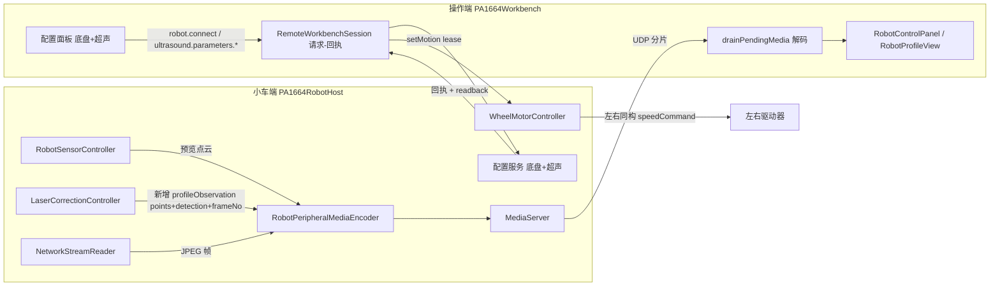
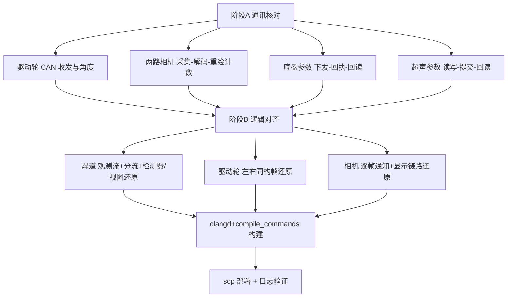

## User Requirements

用户当前遇到三个现象，均以「合体版项目」`D:\dev\deskCrawlingRobot\CrawlingRobotSV\PA1664WorkbenchTmp2` 为业务基准：

- 激光焊道轮廓只有一边显示（截图：X/Z 轮廓左侧一整段平基线、右侧一段上升曲线后平顶，状态文字「基线+肩部：本帧未确认焊道」，底部 `SDK #0 | 25/25 | 32 ms`）。
- 前进、后退时左右驱动轮不能保持同步。
- 两路摄像机画面仍然卡住。

用户明确约束：

- 当前版本只是把「操作端指令下发、数据显示」与「小车端采集、计算、控制」拆成两个进程，**业务逻辑不需要改变**，必须与合体版一致；不得借机发明新算法或改产品行为。
- 合体版目录**只读**，绝不改动其中任何文件，仅用于逐项核对。
- 执行顺序：先确保小车端通讯正常（重点是驱动轮与两路摄像机）、操作端配置参数通讯正常（含超声参数与底盘参数），再排查控制逻辑与功能实现逻辑是否与合体版一致。
- 修改仅限当前工作区；部署仅替换用户已明确授权的小车主机 exe。

## Product Overview

保持现有「操作台 + 小车主机」双进程架构不变，先建立四条链路的可核对证据，再把分离过程中丢失或改动的业务逻辑逐项还原为合体版等价实现，使三个用户可见现象消失。合体版仅作为只读参照基准。

## Core Features

- 通讯核对可验证：驱动轮 CAN 收发、两路相机采集到操作端显示、底盘参数下发与回读、超声参数读写提交与回读，均具备请求-回执与逐级计数，能定位断点而非凭现象猜测。
- 激光焊道视图：X/Z 轮廓左右两侧完整呈现，状态文字正确反映本帧焊道候选与基线/肩部判定，`SDK #帧号` 递增刷新，不再固定为 `#0`。
- 驱动轮：前进/后退时左右轮按同一目标同步转动，不再出现一侧不转或被额外指令打断。
- 相机：两路预览连续刷新，媒体帧到达、解码成功、画面实际重绘三段均有计数，静态画面不被误判为「无新帧」。
- 配置：操作端修改的底盘与超声参数能被小车端接受并应用，参数项与校验口径与合体版等价。
- 视觉表现：轮廓曲线左右对称完整、状态文字与帧号实时更新；两路相机画面连续流畅；底盘运动方向稳定、无单边偏转。

## Tech Stack Selection

- 语言与框架：全部 C++（C++17），Qt 6 / Qt 5.15.2，qmake + MSVC 2022；Qt 信号槽、QThread、QTimer、QImage/QPixmap、QUdpSocket、QSerialPort、QSettings(INI)、QJson。不使用其他语言编写实现代码。
- 传输与编解码：现有 `MediaServer` / `MediaClient`（UDP 分片 + HMAC）、`MediaStreamKind`、`kMediaStream*` 常量、`workbench_data_codec` 的点云/图像/IMU 编解码、`robot_json_codec` 的配置与状态 JSON；现有 `robot.connect`、`ultrasound.parameters.*` 请求-响应通道。
- 硬件侧：OpenCV/FFmpeg RTSP 读取、SLCAN 串口 + `ServoProtocol` CAN 帧、线激光 SDK、超声 SDK `Client`。
- 诊断与部署：`crawling::AppLogger` 分类日志（`MEDIA.TX`、`媒体接收(5s)`、`CAMERA.READER/CONTROLLER/PIPELINE`、`DRIVE.CAN`、`can_rx_stats`）、Windows WER/cdb 转储、PowerShell + SSH/scp；根目录 `compile_commands.json` 与 clangd。
- 硬约束：更新 exe 前必须使用 **clangd + compile_commands** 核对编译单元与语义；本地改动仅限 `d:/dev/deskCrawlingRobot/CrawlingRobotSV/PA1664WorkbenchTmpSeparate`；`PA1664WorkbenchTmp2` 全程只读；远端仅按已授权路径 `C:/Users/a/Desktop/robot_host/app/PA1664RobotHost.exe` 替换 exe 并读取 `app/logs`。

## Implementation Approach

### 总体策略

分两阶段，**先通讯、后逻辑**，严格按用户指定顺序：

1. 阶段 A（通讯核对）：不先改业务逻辑，只补「请求-回执配对」「解码成功/失败」「UI 实际重绘」三类可核对计数，再用现有日志把四条链路逐段读通，给出明确结论。
2. 阶段 B（逻辑对齐）：以只读的合体版为基准，把分离过程中**丢失的数据**或**被改动的实现**还原为等价行为；已确认一致的部分（`wheel_synchronizer.*`、`DifferentialMixer`、`SynchronizedDriveController` 目标混合与新鲜度门、X/Z 坐标映射与对称横轴、焊道检测阈值、`DriveSettings` 字段集、超声 81 个 getterNames）一律不动。

### 阶段 A：四条链路核对

- 驱动轮：`can_rx_stats`（`rx_left_id` / `rx_right_id` / `bel` / `tx_failed`）、`wheel_speed_write`（左右目标与反馈）、`can_speed_frame`（真实帧十六进制）、`left_9c` / `right_9c` 角度变化。当前实测左轮反馈速度恒 0、右轮正常，链路本身健康。
- 两路相机：`rtsp_probe`、`CAMERA.READER`（`emitted=released`）、`CAMERA.CONTROLLER`（`ready=changed=consumed`）、`CAMERA.PIPELINE`（`in=submit=ack`）、主机 `MEDIA.TX`（`usb0/usb1`、`srv_fail`）、操作端 `媒体接收(5s)`。当前实测两路各约 45 帧/5s 到达、`srv_fail` 恒定，但**该计数发生在解码之前**，不能证明画面已显示，因此必须新增「解码成功/失败、setPixmap、视图可见性」计数。
- 底盘参数：`robot.connect` 请求-回执、`driveSettingsFromJson` 与 `validationError()`、下发后 `robot.snapshot` 回读生效值。
- 超声参数：`snapshot` / `getMany` / `apply` / `commit` 请求-回执、readback 值一致性、失败计数。

### 阶段 B：三个现象的根因与还原方向

**现象① 焊道只显示一边 + 「本帧未确认焊道」+ `SDK #0`**

根因是分离后的数据缺失与实现漂移，而非绘图坐标：

- 合体版由 `laser_correction_controller.cpp:1154` 发 `profileObservationReady(points, detection, frameNumber, receivedAtEpochMs)` → `robotcontrolpanel.cpp:302-309` 调 `m_laserView->setProfileObservation(...)`。分离版远程模式不创建本地纠偏线程，`drainPendingMedia()` 对 `LaserPointCloud` 只调 `setLaserProfilePoints(points)` → `RobotProfileView::setPoints()` 把 `m_hasDetection=false`、帧号不更新，而状态文字条件两版相同，故必然显示「未确认焊道」与 `SDK #0`；且 `LaserGapDetection` 没有任何跨进程编解码。
- 主机把 `pointCloudProfileChanged`（≤1000 的 2D 网格预览点）与 `correctionProfileFrameReady`（完整最后一行 rawProfile）送进同一 mailbox / 同一 `LaserPointCloud` 流，两类点集交替显示易得半边曲线。
- `ProfileWeldDetector::detect()`：合体版遇 X 大回跳即 `break` 保留第一段；分离版改成「拆多段、只保留最长 run」，SDK X 序列两段/卷绕时丢弃一个半边。
- `RobotProfileView`：合体版有 `m_renderRetryTimer`，33 ms 节流时排队重试；分离版节流命中直接 `return`，漏一次重绘。

还原方案：新增一条 `LaserProfileObservation` 媒体流与常量，用现有 `workbench_data_codec` 风格把 `points + LaserGapDetection + frameNumber + receivedAtEpochMs` 一并编码下发；主机订阅 `LaserCorrectionController::profileObservationReady` 并转发，同时把「焊道视图点集」与「预览点云」分流，不再混用一个 mailbox；操作端解码后调 `setProfileObservation(...)`；`ProfileWeldDetector::detect()` 与 `RobotProfileView` 的重绘节流恢复为合体版实现。阈值、`XZ` 映射、`±halfSpanX` 对称横轴保持不动。

**现象② 两轮不同步**

`wheel_synchronizer.*`、`DifferentialMixer`、`SynchronizedDriveController` 已逐字一致，**不是同步算法问题**。不一致只在电机下发层：合体版左右轮统一 `ServoProtocol::speedCommand(motorId, encodedSpeedDps)`；分离版加入 `speedFrame.data[3] = leftMotor ? 0x00 : 0x0A`、左轮 stall 后改 `0xF3` legacy 帧、每次 run 前额外 `0x88/0x8C` 与 `waitForReadyRead`、连接时 `probeCanBusIds()` 对两轮分别发多种帧并阻塞等待，以及 3 次恢复试探。一轮 `0xA2`、另一轮 `0xF3` 足以造成不同步。还原方案：恢复左右同构的速度帧下发，移除左右差异分支、legacy 阶梯、额外使能/抱闸与探测帧；保留 `can_rx_stats`、`can_speed_frame` 等纯诊断日志与异常护栏，不改动任何同步器与协议常量。UDP lease `setMotion/clearMotion` 属分离必需链路，保留，但需核对停止时序。

**现象③ 相机卡住但媒体计数正常**

- `m_mediaRxUsb[]++` 在 `onRemoteMediaReceived` 的计数 switch 中完成，早于 30 ms `drainPendingMedia()`、`decodeImagePayload()`、`setUsbCameraImage()`、`setPixmap()`；且 `displayUsbCameraImage()` 有 `isVisible()` 门、无周期性 UI 重绘定时器，主机注释假设的「100 ms UI clock」在分离版并不存在，解码失败也没有日志。
- 独立相机服务链路：`camera_server_main.cpp` 删除了逐帧 `FRAME &lt;slot&gt;` stdout 推送，`camera_server_client.cpp` 改为 33 ms 轮询且仅当 `dataSize != lastFrameSize_[slot]` 才发 `frameReady`，**相同 JPEG 字节长度的连续帧（静态画面）被全部吞掉**。

还原方案：恢复逐帧通知与 `readSlot(slot, false)` 语义（改为按帧序号/时间戳判定新帧，而非仅按字节长度）；在操作端补「解码成功/失败、`setPixmap`、视图可见性、重绘触发」计数与失败日志；为可见视图提供确定性的重绘触发，使缓存变化能反映到界面。**注意不得回退上一轮为修背压死锁而做的 `frameConsumed` 修复**（主机在提交编码后立即确认），否则会重新引入 `busy_` 永久锁死。

**配置通讯**

- 底盘：操作端保存用 `nonPortValidationError()`，而 `driveSettingsFromJson()` 与主机 `robot.connect` 仍用完整 `validationError()`，端口口径不一致时可能被拒；合体版随保存写入的 `laserCorrection/speed|segmentLength|kp|kd|imageTimeoutMs` 五项在分离版只在 `robot.autoCorrection.start` 单独发送。按核对结果统一校验口径并补齐这五项与回读日志。
- 超声：远程 facade 省略了 `getGroupsNo`（固定返回 `{0}`）、`getBeamCounts`（由 first/last/step 推算）、`getBeamPositions` / `setCurrentGroup` / `getCurrentGroup` / 服务器地址端口 ID，TCG 快照只取第 0 点/第 0 beam/group 0，远程模式跳过 TX/RX 写后回读。按阶段 A 的核对结果补齐这些项的 RPC 与回读，保持 81 个常规参数不变。

### 性能、可靠性与避免技术债

- 所有新增计数为常数级、按 2 s / 5 s 窗口聚合输出，不逐帧打印；复用现有 `AppLogger`、`redactStreamUrl`、`MEDIA.TX`、`媒体接收(5s)`、`DRIVE.CAN` 通道，日志限频、URL 凭据脱敏。
- 保持现有 `kUsbImageIntervalMs=100`、`kLaserPointIntervalMs=50`、`kImuIntervalMs=50` 与 `kMaxMediaFragments`，不提升推流频率；新增媒体流复用现有分片/HMAC/`MediaServer`/`MediaClient`，不引入新协议、新线程、新界面。
- 新载荷需有版本/长度校验与解码失败兜底，旧版本操作端遇到未知 `MediaStreamKind` 应安全忽略；保留 `GuardedThread`、`UltrasoundHostService::dispatchRequest`、`main.cpp` 残留锁复核，避免主机再次 abort 或双击秒退。
- 不改动合体版；不改动已确认一致项；不做无关重构；不新增 UI 设计。

## Implementation Notes

- 修改任何符号前按 `AGENTS.md` 先做影响分析；GitNexus MCP 若未注册，按技能回退规则用 LSP + 手工引用核对，若为 HIGH/CRITICAL 风险先报告影响面。不做提交则无需 `detect_changes()`。
- 更新 exe 前必须用根目录 `compile_commands.json` 让 clangd 刷新语义索引，再运行 `build/build_both.bat` 或 `build/host.bat`；禁止绕过 compile_commands。
- 部署前确认远端 `PA1664RobotHost.exe` 未占用，`scp` 覆盖已授权路径，清理 `robot_host.lock`；启动优先由用户在小车桌面 Console 会话执行，远程启动仅用于快速验证并需确认进程存活与会话。
- 验证时保留 `app/dumps` 完整转储能力；若再次崩溃用本机 `cdb.exe` 结合 `build/obj/PA1664RobotHost.pdb` 分析。
- 现场动作（点前进、切换相机/轮廓标签）只提示一次，其余由日志自动核对；用户偏好少提问、直接执行。

## Architecture Design





## Directory Structure

### Directory Structure Summary

本次仅修改当前工作区内 C++ 文件；`PA1664WorkbenchTmp2` 全程只读、零改动。新增媒体载荷复用现有编解码模块，不新建源文件；构建产物与用户已授权的远端 exe 作为受影响项列出。

```
PA1664WorkbenchTmpSeparate/
├── src/
│   ├── common/
│   │   ├── protocol/protocol_types.h                 # [MODIFY] 在 MediaStreamKind 与 kMediaStream* 常量区新增 LaserProfileObservation 种类/流 ID（0x02xx 段），保持既有枚举值不变；核对 kMaxMediaMessageBytes / kMaxMediaFragments 不变。
│   │   ├── services/workbench_data_codec.cpp/.h      # [MODIFY] 新增 profileObservation 载荷编解码：points(沿用 decodePointCloud 的 count+量化格式) + LaserGapDetection 字段 + frameNumber + receivedAtEpochMs；带长度/版本校验、解码失败返回 false；新增 decodeImagePayload 失败原因输出接口或错误日志。
│   │   └── transport/media_channel.cpp/.h            # [AFFECTED] 核对新 MediaStreamKind 在 MediaClient/MediaServer 统计与 packetRejected 分支中不会误判；保留上一轮的 4MB UDP 缓冲、失败重试与限频告警；不改分片协议。
│   ├── backend/
│   │   ├── robot_peripheral_host_service.cpp/.h      # [MODIFY] 订阅 LaserCorrectionController::profileObservationReady 并编码转发新流；把「预览点云」与「焊道视图点集」分流，不再共用同一 mailbox；保留 frameConsumed 修复、CAMERA.PIPELINE 计数与背压死锁修复；新增 profile observation 发送计数。
│   │   ├── host_application.cpp/.h                   # [MODIFY] MEDIA.TX 增加新流的计数与分段统计；保留 GuardedThread 异常护栏；核对 MEDIA_PEER_READY → mediaReceptionActive(true)。
│   │   ├── robot_host_service.cpp                     # [MODIFY] 统一 robot.connect 的校验口径（端口以主机为准，使用 nonPort 等价校验或明确端口覆盖规则）；补下发后 snapshot 回读日志；核对 setMotion lease 停止时序。
│   │   ├── ultrasound_host_service.cpp/.h             # [AFFECTED/MODIFY] 补请求-回执与 readback 一致性日志；按阶段A结果补齐被省略项的 host 端 RPC（组列表、beam 数组、TCG 全量、当前组、设备地址），保留 dispatchRequest 异常护栏。
│   │   ├── ultrasound_parameter_rpc.cpp               # [MODIFY] 按核对结果补齐 getterNames 之外的只读/回读方法与 TCG 数组全量读取；保持既有 81 个参数不变。
│   │   └── main.cpp                                   # [AFFECTED] 保留 QLockFile 残留锁复核；验证稳定启动。
│   ├── services/
│   │   └── ultrasound_parameter_service.cpp/.h        # [MODIFY] 按阶段A结果补齐远程 facade 的 group/beam/当前组/设备信息读取与写后回读；补请求-回执计数与失败日志；保持缓存+批量 RPC 模式。
│   ├── laser_correction_controller.cpp/.h             # [AFFECTED] 只读核对 profileObservationReady 发射点（:1145/:1470）；不改检测阈值与控制算法。
│   ├── profile_weld_detector.h                        # [MODIFY] 将 detect() 的「多段最长 run」还原为合体版「X 大回跳即 break 保留第一段」等价实现；阈值与其余逻辑不动。
│   ├── robot_profile_view.cpp/.h                      # [MODIFY] 恢复 m_renderRetryTimer 与 33ms 节流排队重试；核对 setProfileObservation 与状态文字、SDK 帧号显示；坐标映射与对称横轴不动。
│   ├── robotcontrolpanel.cpp/.h                       # [MODIFY] onRemoteMediaReceived 新增 LaserProfileObservation 分支；drainPendingMedia 解码后调 setProfileObservation；新增解码成功/失败、setPixmap、视图可见性计数与失败日志；为可见相机视图提供确定性重绘触发；补配置请求-回执与参数回读日志；保留 remote.peripheral.log 显示与既有链路诊断。
│   ├── camera_server_main.cpp                         # [MODIFY] 恢复逐帧 FRAME &lt;slot&gt; stdout 推送（含帧序号），与合体版一致。
│   ├── camera_server_client.cpp/.h                    # [MODIFY] 恢复收到 FRAME 即 readSlot(slot,false) 的逐帧读取，改用帧序号/时间戳判定新帧，去掉「仅 JPEG 字节长度变化」去重；保留轮询兜底。
│   ├── robot/
│   │   ├── wheel_motor_controller.cpp/.h              # [MODIFY] 恢复左右轮统一 ServoProtocol::speedCommand 下发；移除 data[3] 左右差异、0xF3 legacy 阶梯、run 前额外 0x88/0x8C、连接时 probeCanBusIds 多帧阻塞试探与恢复试探；保留 can_rx_stats / can_speed_frame 纯诊断与 initialize 状态复位；修正中英混杂注释。
│   │   ├── servo_protocol.cpp/.h                      # [AFFECTED] 核对 speedCommand/runCommand/brakeCommand/parseStatus 与合体版编码一致；不改协议常量。
│   │   ├── wheel_synchronizer.cpp/.h                  # [AFFECTED] 已确认一致，只读核对，禁止修改。
│   │   ├── differential_mixer.cpp                     # [AFFECTED] 已确认一致，只读核对，禁止修改。
│   │   └── synchronized_drive_controller.cpp          # [AFFECTED] 目标混合与新鲜度门一致，只读核对，禁止修改。
│   ├── robot_usb_camera_controller.cpp/.h             # [AFFECTED] 保留上一轮 CAMERA.CONTROLLER 计数、frameConsumed 修复与网络重连逻辑；核对 displaySize/缩放/flip 下发。
│   └── network_stream_reader.cpp/.h                   # [AFFECTED] 保留 CAMERA.READER 背压计数、OpenCV 异常捕获与 DNS/TCP/RTSP 分段探针；不改取帧频率。
├── robot_comm_test/main.cpp                           # [AFFECTED] 用现有 --enable/--clamp 只读探测能力复测驱动轮通讯，不改测试协议。
├── bin/
│   ├── PA1664RobotHost.exe                             # [AFFECTED] 主机构建产物；更新前必须使用 clangd + compile_commands。
│   ├── PA1664Workbench.exe                             # [AFFECTED] 操作端构建产物。
│   ├── config/drive_settings.ini                       # [AFFECTED] 只读核对操作端配置与主机实际端口/轴布局/网络相机地址一致。
│   └── logs/robot_console.log                          # [AFFECTED] 验证 媒体接收(5s)、LINK.CONTROL、SESSION、新增显示计数。
├── startup_deploy/robot_host/app/PA1664RobotHost.exe   # [AFFECTED] 工作区内部署副本。
├── build/
│   ├── build_both.bat / host.bat                       # [AFFECTED] 两端/单主机构建入口。
│   ├── obj/PA1664RobotHost.pdb                          # [AFFECTED] cdb 分析符号。
│   └── crash*.dmp                                      # [AFFECTED] 已拉取转储，验证修复后不再新增。
└── compile_commands.json                               # [AFFECTED] clangd 语义索引输入；更新 exe 前后用它核对编译单元。

只读基准（零改动）
D:/dev/deskCrawlingRobot/CrawlingRobotSV/PA1664WorkbenchTmp2/
├── src/robot_profile_view.cpp / profile_weld_detector.h / laser_gap_detector.h   # 焊道视图与检测器基准
├── src/laser_correction_controller.cpp / robotcontrolpanel.cpp                     # profileObservationReady 链路与配置写入基准
├── src/robot/wheel_motor_controller.cpp / wheel_synchronizer.cpp / differential_mixer.cpp / synchronized_drive_controller.cpp  # 驱动轮基准
├── src/camera_server_main.cpp / camera_server_client.cpp / robot_usb_camera_controller.cpp  # 相机基准
└── src/parameterpanel.cpp / services/* / vendor/phaselink/include/client.h        # 超声参数与 SDK 方法基准

用户已授权远端（仅替换 exe、其余只读）
C:/Users/a/Desktop/robot_host/
├── app/PA1664RobotHost.exe                             # [AFFECTED] 仅按授权通过 scp 覆盖。
├── app/robot_host.lock                                 # [AFFECTED] 部署前清理残留锁。
├── app/logs/robot_host.log                             # [AFFECTED] 读取 MEDIA.TX、CAMERA.*、DRIVE.CAN、can_rx_stats、wheel_speed_write。
├── app/logs/robot_console.log                          # [AFFECTED] 读取 CAMERA.READER/CONTROLLER/PIPELINE。
├── app/logs/camera_connection.log                      # [AFFECTED] 读取 rtsp_probe、stream_exception。
└── app/dumps/                                          # [AFFECTED] 完整转储目录，验证无新增主机崩溃。
```

## Key Code Structures

仅给出跨进程新增契约与必须精确的接口（实现体不在此给出）：

```cpp
// src/common/protocol/protocol_types.h —— 新增，不改变既有枚举值
// enum class MediaStreamKind : quint8 { ... LaserProfileObservation = 10, };
// inline constexpr quint16 kMediaStreamProfileObservation = 0x0204;

// src/common/services/workbench_data_codec.h —— 跨进程载荷契约
QByteArray encodeProfileObservation(
    const QVector&lt;QVector3D&gt;&amp; points,
    const crawling::LaserGapDetection&amp; detection,
    quint32 frameNumber, qint64 receivedAtEpochMs);
bool decodeProfileObservation(
    const QByteArray&amp; payload,
    QVector&lt;QVector3D&gt;* points,
    crawling::LaserGapDetection* detection,
    quint32* frameNumber, qint64* receivedAtEpochMs);

// 已有接口（保持签名不变，仅恢复调用）
// void RobotProfileView::setProfileObservation(
//     const QVector&lt;QVector3D&gt;&amp; points,
//     const crawling::LaserGapDetection&amp; detection,
//     quint32 frameNumber, qint64 receivedAtEpochMs);
// void LaserCorrectionController::profileObservationReady(...);  // 主机侧信号，转发用
```

`LaserGapDetection` 字段较多，编码时按 `src/laser_gap_detector.h:141` 结构体逐字段显式读写（布尔/整数/浮点/向量），带字段数量与载荷长度校验，缺失字段按默认值处理，保证旧版本操作端遇到新 `MediaStreamKind` 可安全忽略。

## Agent Extensions

### SubAgent

- **code-explorer**
- Purpose: 阶段 A 以 very thorough 程度只读跨目录核对四条通讯链路（驱动轮 CAN、两路相机采集-解码-显示、底盘参数、超声参数）的请求-回执与计数落点；阶段 B 逐项比对合体版基准与分离版的焊道/驱动轮/相机实现差异。
- Expected outcome: 输出带「文件:行号」的四条链路断点清单与三块逻辑差异清单，并明确标注「已一致项（禁改）」，确保 Tmp2 零改动、不误改同步器等一致模块。

### Skill

- **gitnexus-debugging**
- Purpose: 跟踪 `profileObservationReady`、`drainPendingMedia`、`decodeImagePayload`、`frameReady`、`sendSpeed` 的执行流，定位「焊道半边」「相机卡住」「两轮不同步」各自断点。
- Expected outcome: 形成可核对的调用链与每层计数预期，证明断点在跨进程数据缺失、显示链路还是电机下发层。MCP 未注册时按技能回退用 LSP + 手工引用核对。
- **lsp-code-analysis**
- Purpose: 精确核对 `LaserGapDetection`、`setProfileObservation`、`MediaStreamKind`、`frameConsumed`、`releaseFrame`、`speedCommand`、`profileObservationReady` 的定义、引用与调用层级。
- Expected outcome: 精确符号清单，避免误改同名函数、旧 generation 回调、RS485 分支或已确认一致项。
- **gitnexus-impact-analysis**
- Purpose: 修改 `RobotPeripheralHostService`、`RobotControlPanel`、`RobotProfileView`、`ProfileWeldDetector`、`WheelMotorController`、`CameraServerClient`、`UltrasoundParameterService` 前评估上游调用者、执行流与风险级别。
- Expected outcome: 给出 blast radius；HIGH/CRITICAL 先报告再修改；确认不影响点云预览、IMU、超声、夹子、右轮与 `wheel_synchronizer.*`。MCP 未注册时按技能回退为 LSP + 手工引用影响分析。